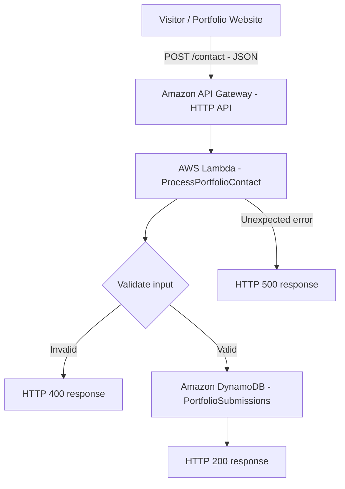

# Serverless-Portfolio-Contact-Form-on-AWS
A serverless contact form backend built with Amazon API Gateway, AWS Lambda, and Amazon DynamoDB. A responsive HTML/CSS/JavaScript portfolio frontend sends contact submissions to an HTTP API. Lambda validates the request and stores accepted submissions in DynamoDB.
# Project 1: Serverless Portfolio Contact Form on AWS

A serverless contact form backend built with **Amazon API Gateway, AWS
Lambda, and Amazon DynamoDB**. A responsive HTML/CSS/JavaScript
portfolio frontend sends contact submissions to an HTTP API. Lambda
validates the request and stores accepted submissions in DynamoDB.

> **Region used:** `ap-south-1` (Mumbai)\
> **Status:** Backend and frontend integration tested successfully. S3
> static hosting and CloudFront distribution were intentionally
> postponed.

## Architecture



## AWS resources

  Resource                      Name / configuration
  ----------------------------- ----------------------------------------
  DynamoDB table                `PortfolioSubmissions`
  Partition key                 `SubmissionID` (String)
  Lambda function               `ProcessPortfolioContact`
  Lambda runtime                Python 3.11
  Lambda environment variable   `TABLE_NAME=PortfolioSubmissions`
  Lambda IAM permission         `dynamodb:PutItem` on the target table
  API Gateway                   `PortfolioAPI` (HTTP API)
  Route                         `POST /contact`
  Stage                         `$default` (auto-deploy enabled)
  AWS Region                    `ap-south-1`

### API endpoint

``` text
POST https://emyt2wv7ei.execute-api.ap-south-1.amazonaws.com/contact
Content-Type: application/json
```

Example request body:

``` json
{
  "name": "Jane Developer",
  "email": "jane@example.com",
  "message": "I would like to discuss a project."
}
```

Do not use real personal information in screenshots or public example
requests.

## Prerequisites

-   AWS account.
-   An IAM identity with permission to create and manage the resources
    used in this lab. Avoid using the AWS root user for routine work.
-   AWS Console access.
-   A browser and a code editor such as VS Code.
-   Optional: AWS CLI and Postman for testing.

Check AWS CLI configuration:

``` powershell
aws --version
aws sts get-caller-identity
aws configure list
```

Set the region for commands in the current PowerShell session:

``` powershell
$env:AWS_DEFAULT_REGION = "ap-south-1"
```

If you use a named profile:

``` powershell
$env:AWS_PROFILE = "YOUR_PROFILE_NAME"
aws sts get-caller-identity
```

Never paste access keys, secret keys, session tokens, `.env` files, or
account-sensitive credentials into GitHub or screenshots.

## Build steps

### 1. Create the DynamoDB table

In AWS Console:

1.  Open **DynamoDB → Tables → Create table**.
2.  Table name: `PortfolioSubmissions`.
3.  Partition key: `SubmissionID`.
4.  Key type: String.
5.  Use on-demand capacity for this learning project.
6.  Create the table and wait until its status is **Active**.

Optional CLI verification:

``` powershell
aws dynamodb describe-table --table-name PortfolioSubmissions --region ap-south-1
```

### 2. Create the Lambda function

In AWS Console:

1.  Open **Lambda → Create function**.
2.  Choose **Author from scratch**.
3.  Function name: `ProcessPortfolioContact`.
4.  Runtime: Python 3.11.
5.  Create or select an execution role for the function.
6.  Create the function.
7.  Add the application code and deploy it.

The function should: - Parse the incoming JSON body. - Validate `name`,
`email`, and `message`. - Reject missing or invalid fields with HTTP
400. - Generate a unique submission ID and UTC timestamp. - Store
accepted submissions in `PortfolioSubmissions`. - Return an HTTP 200
response for successful submissions. - Return an HTTP 500 response for
unexpected server errors.

Set the Lambda environment variable:

``` text
TABLE_NAME = PortfolioSubmissions
```

### 3. Give Lambda permission to write to DynamoDB

Attach a least-privilege policy to the Lambda execution role. The policy
should allow only `dynamodb:PutItem` on the `PortfolioSubmissions`
table.

Find the table ARN in DynamoDB → Tables → `PortfolioSubmissions` →
Overview. Use that exact ARN in the policy; do not copy credentials or
use broad administrator permissions.

### 4. Create the API Gateway HTTP API

In AWS Console:

1.  Open **API Gateway → Create API → HTTP API**.
2.  API name: `PortfolioAPI`.
3.  Add a Lambda integration targeting `ProcessPortfolioContact`.
4.  Create route `POST /contact`.
5.  Use the `$default` stage and enable auto-deploy.
6.  Configure CORS to allow the frontend origin, `POST`, and the
    `content-type` header.

For the initial learning test, the project used `*` as the allowed
origin. Before production, replace it with the exact deployed website
origin. Do not enable credentialed CORS with a wildcard origin.

Copy the API invoke URL and append `/contact`.

### 5. Create the frontend

Create an `index.html` page with: - Name, email, and message fields. -
Client-side required-field checks. - A `fetch()` POST request to the API
endpoint. - JSON request body and `Content-Type: application/json`. -
Success and error feedback for the visitor.

Example request logic:

``` javascript
const API_URL =
  "https://emyt2wv7ei.execute-api.ap-south-1.amazonaws.com/contact";

async function submitContact(formData) {
  const response = await fetch(API_URL, {
    method: "POST",
    headers: {
      "Content-Type": "application/json"
    },
    body: JSON.stringify({
      name: formData.name,
      email: formData.email,
      message: formData.message
    })
  });

  const result = await response.json();

  if (!response.ok) {
    throw new Error(result.message || "Unable to submit the form");
  }

  return result;
}
```

Adapt the field names and response handling to match the Lambda
function's actual implementation.

## Testing

### Test 1: Valid request with Postman

-   Method: `POST`
-   URL:
    `https://emyt2wv7ei.execute-api.ap-south-1.amazonaws.com/contact`
-   Header: `Content-Type: application/json`
-   Body: raw JSON with valid `name`, `email`, and `message`.

Expected result: HTTP `200` and a success response containing the
submission identifier (depending on the Lambda response implementation).

### Test 2: Invalid request

Send a request with a required field missing or an empty message.

Expected result: HTTP `400`.

### Test 3: Browser frontend

1.  Open the local `index.html` in a browser or serve it from a local
    development server.
2.  Fill out the contact form with test data.
3.  Submit the form.
4.  Confirm that the success message appears.
5.  Check the browser Developer Tools → Network tab for the POST request
    and response.

### Test 4: Verify DynamoDB records

``` powershell
aws dynamodb scan --table-name PortfolioSubmissions --region ap-south-1
```

For a production application, prefer paginated queries and avoid
exposing table data publicly. The `scan` command is used here only for a
small learning table.

## Screenshots to capture

Create a folder named `screenshots` in your repository and add your own
screenshots. Suggested filenames:

  --------------------------------------------------------------------------
  Filename                               What to capture
  -------------------------------------- -----------------------------------
  `01-dynamodb-table.png`                DynamoDB table overview showing
                                         `PortfolioSubmissions` and
                                         partition key

  `02-lambda-function.png`               Lambda function overview showing
                                         function name and Python runtime

  `03-lambda-environment-variable.png`   Lambda configuration showing
                                         `TABLE_NAME` (no secrets)

  `04-lambda-iam-policy.png`             Execution role policy showing
                                         restricted `dynamodb:PutItem`
                                         permission

  `05-api-gateway-route.png`             HTTP API route showing
                                         `POST /contact` and Lambda
                                         integration

  `06-api-cors.png`                      CORS configuration (show the final
                                         allowed origin; redact anything
                                         sensitive)

  `07-postman-success.png`               Valid POST request with HTTP 200

  `08-postman-validation-error.png`      Invalid POST request with HTTP 400

  `09-frontend-contact-form.png`         Portfolio contact form in the
                                         browser

  `10-frontend-success.png`              Successful form submission in the
                                         browser

  `11-dynamodb-items.png`                DynamoDB Explore items showing test
                                         records; use fake test data

  `12-browser-network.png`               Browser Network tab showing POST
                                         request and successful response
  --------------------------------------------------------------------------

Only add screenshots you actually captured. Do not fabricate screenshots
or include AWS access keys, secret keys, session tokens, private
customer data, or sensitive account information.

## Repository layout

``` text
project-1-serverless-portfolio/
├── README.md
├── index.html
└── screenshots/
    ├── 01-dynamodb-table.png
    ├── 02-lambda-function.png
    ├── 03-lambda-environment-variable.png
    ├── 04-lambda-iam-policy.png
    ├── 05-api-gateway-route.png
    ├── 06-api-cors.png
    ├── 07-postman-success.png
    ├── 08-postman-validation-error.png
    ├── 09-frontend-contact-form.png
    ├── 10-frontend-success.png
    ├── 11-dynamodb-items.png
    └── 12-browser-network.png
```

## Cleanup and cost control

This project was tested successfully, but the resources were not
confirmed as deleted. If you want to stop using the project, identify
and delete the resources you created:

1.  Remove the API Gateway HTTP API `PortfolioAPI`.
2.  Delete the Lambda function `ProcessPortfolioContact`.
3.  Delete the DynamoDB table `PortfolioSubmissions` **only if you no
    longer need its data**.
4.  Review CloudWatch log groups created for the Lambda function and
    delete them if no longer required.

Before deleting the DynamoDB table, export or back up any records you
want to keep. Check the AWS Billing console for any remaining charges.

## What I learned

-   Serverless architecture and event-driven request processing.
-   Creating and configuring a DynamoDB table.
-   Writing a Python Lambda handler.
-   Applying least-privilege IAM permissions.
-   Exposing Lambda through API Gateway HTTP API.
-   Configuring CORS for browser-based frontend requests.
-   Testing REST endpoints with Postman and browser Developer Tools.
-   Verifying persisted records in DynamoDB.

## Future improvements

-   Host the frontend in a private S3 bucket and distribute it through
    CloudFront with Origin Access Control (OAC).
-   Restrict CORS to the exact CloudFront website origin.
-   Add AWS WAF, request throttling, and stronger validation.
-   Add automated deployment and monitoring.
-   Add retention and backup policies for stored submissions.
